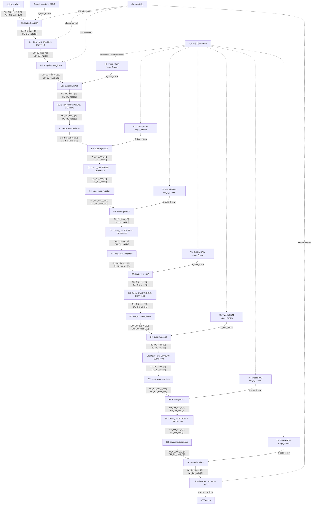

# NTT engine architecture

This directory implements a 256-coefficient forward ML-DSA NTT over
`Q = 8380417`. The top-level module is `NTT_engine` in
[`RTL/NTT_engine.v`](RTL/NTT_engine.v). `DesignParam.vh` sets `N = 256`, `DATA_WIDTH = 23`, and
`Q_WIDTH = 32`. Each valid transfer contains **two coefficients**.

## Block diagram

The diagram shows the data and valid path. `B1` through `B8` are separate
`ButterflyUnitCT` instances. `D1` through `D7` are `Delay_Unit` instances;
`R2` through `R8` are the input registers between each delay unit and the
next butterfly, implemented in `NTT_engine`. Each `Tk` is a separate
`TwiddleROM` instance. `*` in an edge label stands for the `a` and `b`
data buses with the same prefix.



The shared `clk`, `rst`, and `stall_i` controls apply to all butterflies,
delay units, and stage registers, as well as `PairReorder`. The ROMs receive
`clk` and `stall_i`; their address counters receive `clk` and `rst`.
`Delay_Unit` uses four `FIFO` instances to regroup pairs for the next CT
stage. A butterfly computes `t = b * zeta mod Q`, then outputs
`(a + t) mod Q` and `(a - t) mod Q`. Its `w` input is the Montgomery
representation of `zeta`, and its arithmetic pipeline has five registered
steps. There is no inverse-NTT normalization block in this forward engine.

Twiddle files `TwiddleFactors/stage_1.mem` through `stage_8.mem` contain
forward Montgomery twiddles in reference group order. Stage 1 uses the
equivalent hardcoded value `25847`; stages 2–8 use synchronous ROMs. The
delay network interleaves groups, so each stage's ROM counter is bit
reversed over that stage's address width before the read. The counter
advances with the corresponding valid pair and pauses during a stall.

## Input order

Let `x[0]` through `x[255]` be a polynomial in ordinary array index order.
For each frame, send **128 accepted pair transfers**. On accepted transfer
`p`, with `p = 0..127`, drive:

```text
a_i = x[bit_reverse_8(2*p)]     = x[bit_reverse_7(p)]
b_i = x[bit_reverse_8(2*p + 1)] = x[bit_reverse_7(p) + 128]
valid_i = 1
```

`bit_reverse_k` reverses exactly `k` low bits. The first transfers are:

| Accepted pair `p` | `a_i` | `b_i` |
| ---: | --- | --- |
| 0 | `x[0]` | `x[128]` |
| 1 | `x[64]` | `x[192]` |
| 2 | `x[32]` | `x[160]` |
| 3 | `x[96]` | `x[224]` |
| 4 | `x[16]` | `x[144]` |
| 127 | `x[127]` | `x[255]` |

Each pair supplies the two operands of a stage-1 butterfly. Inputs must be
canonical residues in `[0, Q-1]`; the current C-reference vectors happen
to use binary coefficients. `valid_i = 0` inserts a bubble and does not
advance the pair count. `stall_i = 1` freezes the pipeline, so the source
must retry any pair it has not yet transferred. Reset starts a new frame.

## Output order

Let `y[0]` through `y[255]` be the forward NTT result in the Dilithium C
reference array order. That reference order is bit-reversed with respect
to mathematical frequency indices. The last CT butterfly produces correct
`(y[2*j], y[2*j+1])` pairs, but its group index `j` arrives in
`bit_reverse_7(p)` order. `PairReorder` writes each pair to that address,
waits for all 128 pairs of a frame, then reads addresses `0..127`.

On the `p`-th **accepted output** after `valid_o` asserts:

```text
a_o = y[2*p]
b_o = y[2*p + 1]
```

Thus the output stream begins `(y[0], y[1])`, `(y[2], y[3])`, and ends
with `(y[254], y[255])`. Two banks in `PairReorder` allow the next frame
to enter while the previous frame is read. Count an output pair only when
`valid_o = 1` and `stall_i = 0`; outputs and validity hold during stalls.

## Verification

Run `make lint` and `make sim` from `Verif/`. Its Cocotb tests compare the result with the
Dilithium C reference, including consecutive frames, bubbles, and stalls.
